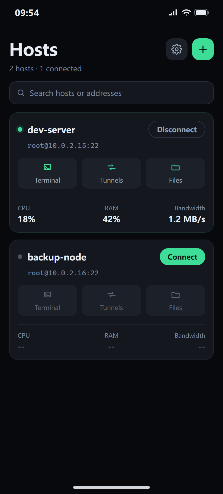
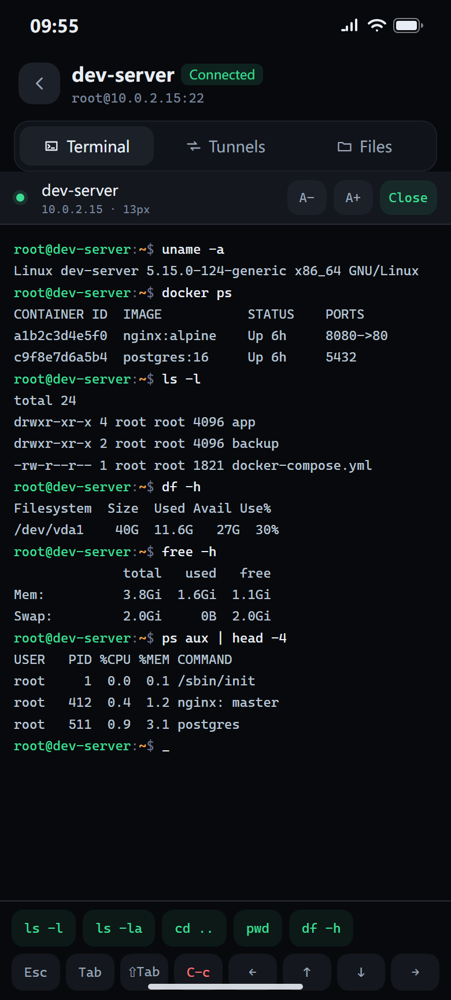
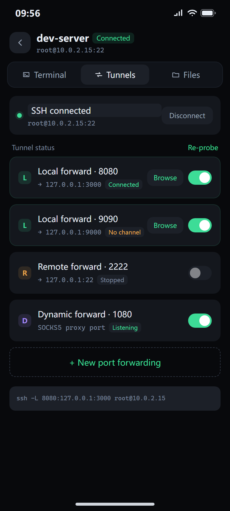
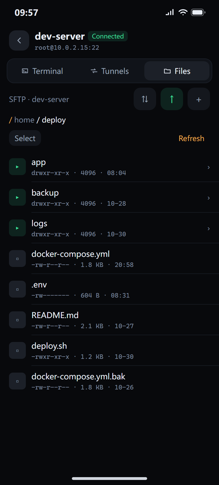

# Skiff

**Version** HarmonyOS 0.3.7 · Windows 0.1.14 · **License** MIT

**SSH, tunnels and file transfer — on a HarmonyOS phone and on Windows.** The phone build is rebuilt for portrait use: one-tap forwarding, and a built-in browser that opens the server panel the moment the tunnel is up. The desktop build is a single portable exe: sidebar of hosts, tabbed terminal, two-pane SFTP.

[中文](README.md) · [Changelog](CHANGELOG.md)

## Two editions

| | HarmonyOS | Windows |
|---|---|---|
| Form | Phone app (ArkTS + ArkUI) | Portable exe, no install, no runtime dependencies |
| Platform | HarmonyOS 6.1 (API 24) | Windows 10 / 11 x64 |
| Interaction | Portrait touch, six-row extended keyboard | Mouse and keyboard, collapsible sidebar, tabs |
| Forward types | Local L / remote R / dynamic D | Local L / remote R |
| Viewing a panel | Built-in browser (ArkWeb) | Probes the channel, then opens your default browser |
| Signing | Unsigned package, sign it yourself | Unsigned exe |

Both editions share one C++ SSH core (libssh2); the UI layers are separate.

## Why this exists

I am a user first, not an ops engineer.

My services run on a cloud server, but almost everything I do with them happens on a phone — while commuting, queuing, or lying in bed. I do not want to expose panel ports to the public internet. The safer pattern is to expose only SSH, forward the internal port over a tunnel when needed, and open it in a browser.

On a desktop this is fluid: `ssh -L 8080:127.0.0.1:3000 user@host`, then open the browser. On a phone the flow falls apart.

I tried what already exists, and none of it fit:

- **Full-featured clients**: desktop-class SSH tools ported to mobile. Menus, sheets and dialogs stacked several levels deep — painful on a 6-inch screen. And once the tunnel is up you still switch to another app to open the link.
- **Lightweight options**: terminal only. Tunnels mean typing the command by hand, or are not supported at all.
- **What all of them miss**: no graphical one-tap tunnel setup, and no built-in browser that opens the forwarded local port. You end up bouncing between two apps.
- **Language**: several well-made tools ship with an English-only UI.

So I built the tool I wanted: **portrait-first, three steps to a working tunnel, a built-in browser that opens it immediately, and a UI in both Chinese and English.**

AI tooling took the repetitive engineering work off my hands, and the protocol core builds on an existing open-source implementation (upstream [CrossShellNext](https://gitcode.com/OpenHarmonyPCDeveloper/CrossShellNext)), so the effort went into "how should this feel on a phone".

Once the phone build was done I wanted the same thing while sitting at a desk: no typing on a phone, and no feature-stuffed desktop client that takes five clicks to do anything. So the same protocol core went to Windows, with a "sidebar of hosts + tabs" layout, packed as a single exe — copy it, double-click it, and settings, logs and keys travel with it.

## What it replaces

| Before | After |
|---|---|
| Two apps on the phone: an SSH client and a browser | One app, tunnel and browser in the same session |
| Type `ssh -L 8080:127.0.0.1:3000 user@host`, then paste the URL into a browser | Enter the port and target, flip the switch, tap **Browse** |
| You only know the tunnel works when the browser fails | The local port is probed first; you get a hint instead of a blank page |
| The switch says "on" but the tunnel is dead | Periodic health checks rebuild dead forwards automatically |
| Digging through an English UI for settings | Chinese and English, switched instantly in Settings |
| A big desktop client with config scattered across the registry and your user profile | One exe; config and keys sit next to it, so copying the folder migrates everything |
| Closing a terminal window means disconnecting, then waiting to reconnect | Closing a tab keeps the session alive; reopening it lands on the same screen |
| Resizing the window scrambles the grid; `bash` title escapes leak onto the screen | PTY size is pushed to the server; CSI / OSC / DCS are fully parsed |

## Features · HarmonyOS

### Connections and authentication

- **The host list is the home screen**: no auto-connect on launch; each card shows a status dot, the host name and live CPU / RAM / network usage (sampled every 5 seconds, greyed `--` when offline)
- **Three shortcuts per card**: **Terminal / Tunnels / Files** connect the host and jump straight into that view
- **Authentication**: password (masked) and private key (RSA 2048 / ECDSA P-256 / Ed25519, generatable inside the app)
- **Host key verification**: the server fingerprint is recorded on first connect (TOFU) and compared before every later authentication; a changed key is rejected with the actual fingerprint shown. Editing the address or port clears the stored key.
- **Concurrent sessions**: different hosts stay connected side by side
- **Proxy**: SOCKS5 and HTTP, with a connectivity test before connecting

### Terminal

- Real PTY output rendered by xterm.js, bundled Cascadia Mono, adjustable font size
- **Six-row extended keyboard**: letters, digits and symbols, control keys, arrows and editing keys in separate groups; `Shift` / `Caps` behave independently, `Ctrl` / `Alt` combinations pass through, `Del` and `⌫` send their own control sequences
- One segmented control switches between Terminal / Tunnels / Files inside a session; the session bar keeps the host name and disconnect action
- Output is batched per frame (16 ms / 32 KB thresholds) so long scrolls stay smooth

### Port forwarding

- Separate forms for **local (L) / remote (R) / dynamic (D)**, each generating the equivalent `ssh -L/-R/-D` command line for verification
- Toggles start and stop real forwards; failures roll back to off with a reason, and are disabled while the host is not connected
- **10-second health checks** compare real forward counters: unhealthy tunnels are stopped and rebuilt with backoff, and a dead forward is never reported as "on"
- A local forward jumps to the **built-in browser**, probing the local port first

### Browser

- ArkWeb filling the session area, with an icon toolbar (close / back / forward / reload)
- Load failures give a reason and a retry entry; timeouts show a diagnostic overlay instead of a black screen

### Files (SFTP)

- Directory browsing, breadcrumbs, multi-select, new folder, rename, delete (recursive for folders)
- Upload and download queue with progress, pause, resume and cancel; failures surface the original kernel error

### Logs and diagnostics

- **Session logs**: one file per session, viewable, exportable and clearable, keeping the latest 19
- **Application logs**: connections, forwards, exceptions and crashes written daily to the sandbox, shown separately from session logs
- **Global error capture**: uncaught exceptions and crash reasons persisted for later inspection

### Appearance and language

- Light and dark themes, applied instantly without rebuilding pages
- Chinese and English, Chinese by default, switched in Settings and persisted; system controls follow the app language
- Hosts, tunnels, theme, language, font size and connection behaviour all survive a restart

## Features · Windows

### Form

- **Single portable exe**: static CRT and statically linked libssh2 (WinCNG backend, no OpenSSL); unzip and run
- **Data travels with the program**: `skiff_store.json`, `logs\` and `keys\` live next to the exe; if that directory is not writable it falls back to `%LOCALAPPDATA%\Skiff\`
- **Fully custom-drawn UI**: Win32 + Direct2D / DirectWrite, no system controls, DPI aware
- **Collapsible sidebar**: 360 px expanded with host cards, 52 px collapsed to an icon rail; the state is remembered

### Hosts and connections

- The sidebar host list is the main working area: search, sort by name or last connected, mouse-wheel scrolling
- **Live usage on each card**: CPU / RAM / network rate in three cells, sampled from `/proc` every 5 seconds; above 60% turns amber, above 85% turns red, `--` when disconnected
- **Four shortcuts per card**: Connect / Terminal / Tunnels / Files. A single click on Connect does not change the view; double-clicking the card opens the terminal
- Password and private-key login; keys in `keys\` are matched by file name. If a host has no credential, its edit form opens with a hint instead of failing silently
- Host key verification (TOFU): recorded on first connect, compared afterwards, mismatch rejected with the actual fingerprint shown
- Automatic reconnect with exponential backoff, connect-on-launch, restore-last-view
- Home view: host and tunnel counters, the three most recent hosts, registration and expiry reminders, and a full summary

### Terminal

- Real PTY; grid changes push `winch` to the remote, so resizing the window no longer scrambles output
- Cursor blinks every 530 ms and hides when the window loses focus
- Full CSI / OSC / DCS parsing: the escape sequence `bash` uses to set the window title never reaches the screen
- **Closing a tab does not disconnect**: the tab disappears, the session keeps running and reading, and reopening returns to the same screen contents
- Tab bar, `Ctrl+1`–`Ctrl+4` to switch, `Ctrl+0` for home, `Ctrl+W` to close a tab
- Adjustable font, size, cursor style and UI scale; `Ctrl+wheel` zooms instantly

### Port forwarding

- **Local L / remote R** rules; the form shows the host it belongs to and the equivalent command line
- The switch really starts and stops the forward; a failure rolls back to off with the reason shown
- **10-second health checks** read the real forward counters and distinguish `up` / `listen` / `down`. Dead forwards are rebuilt with backoff (10 / 20 / 40 / 60 s cap); a dead forward is never reported as "on"
- **Open channel**: one button per rule probes `127.0.0.1:<port>`; if it answers, a panel shows the address with **Open in browser** and **Copy address**. If not, you get an explanation and the row is downgraded to not-connected

### Files (SFTP)

- Two panes side by side: local and remote directories, breadcrumbs, multi-select, new folder
- Uploads and downloads run through a background queue serially with live progress, without blocking the terminal
- Failures surface the kernel's own error message

### Appearance and language

- 18 settings across six groups: General / Appearance / Terminal / Connection / Logs / About
- Five accent colours, UI scale, monospace font and size, cursor style
- 287 bilingual strings, switched at runtime
- Log level, retention days, and one-click open/clean of the log directory

### Shortcuts

| Key | Action |
|---|---|
| `Ctrl+0` | Back to home |
| `Ctrl+1` – `Ctrl+4` | Switch to the first four tabs |
| `Ctrl+W` | Close the current tab (does not disconnect) |
| `Ctrl+wheel` | Zoom the terminal font |
| `Ctrl+C` / `Ctrl+V` | Copy / paste (copies the selection when there is one) |

## Use cases

**1. Open a server panel from your phone**
Container managers, dashboards and admin panels usually listen on `127.0.0.1` only. Create a local forward that maps the panel port to the phone, tap **Browse**, and keep the port closed to the internet.

**2. Quick config edits and log reading**
A full PTY: `vim`, `tail -f`, `systemctl` all work. The six-row keyboard supplies the `Esc`, `Tab`, `Ctrl` and arrow keys phone keyboards lack.

**3. Moving files between phone and server**
Upload and download in the SFTP panel with a queue and progress; failures show the kernel's own message instead of a generic "upload failed".

**4. Understanding what actually happened after a disconnect**
Session and application logs are stored separately, so you can read them by timestamp instead of blindly reconnecting.

## Screenshots

**HarmonyOS**: rendered on a 390×863vp portrait baseline; host name and address are placeholders.

| Hosts | Terminal |
|:---:|:---:|
|  |  |

| Port forwarding | File browser |
|:---:|:---:|
|  |  |

## Running it

### HarmonyOS

#### Requirements

- DevEco Studio with the SDK aligned to API 24 / HarmonyOS 6.1; `DEVECO_HOME` pointing at the install directory
- A HarmonyOS emulator (x86_64) or device (arm64-v8a)
- Build caches preferably on a non-system drive (`HVIGOR_USER_HOME`)

#### Build and package

`release.py` handles version bump, build, removal of unconfigured signing entries, and artifact plus SHA256 collection in one pass:

```bash
git clone <this repository>
cd Skiff
python release.py                  # release build (arm64-v8a)
python release.py --abi both       # both ABIs
python release.py --debug          # debug build
python release.py --no-bump        # keep the current version
python release.py --dry-run        # print the steps only
```

On Windows you can double-click `release.bat`. Artifacts land in `产出/` outside the repository, together with `.sha256` files.

#### Install

```bash
hdc install 产出/Skiff-<version>-arm64-v8a-release-unsigned.hap
```

You can also open the project in DevEco Studio and run it, which is equivalent to
`hvigorw assembleHap --mode module -p product=default -p buildMode=debug --no-daemon` (`hvigorw` ships with DevEco Studio, not this repository).

#### First run

1. Tap **+** on the home screen: enter address, port and user, choose password or key, save
2. Tap **Connect** on the card; the host key fingerprint is recorded on first use (TOFU)
3. Tap **Terminal / Tunnels / Files** on the card to enter a session; the segmented control switches views at any time
4. In Tunnels, tap **+ New forward**: choose the type (L/R/D), enter the local port and target, save, then flip the switch
5. With a local forward on, tap **Browse** to open the forwarded port in the built-in browser

#### Native dependencies

The C++ core statically links **libssh2 1.11.1 + OpenSSL 1.1.1w**. Both `entry/libs/arm64-v8a/` and `entry/libs/x86_64/` are included and selected by the build script via `OHOS_ARCH`.

### Windows

#### Requirements

- Visual Studio 2022 (MSVC v143 toolchain)
- CMake and Ninja (the copies bundled with Visual Studio are fine)
- No other dependencies: libssh2 and the static CRT ship with the repository, so the output needs no runtimes

#### Build

```bat
cd win
build.bat
```

Set `VSDIR` at the top of the script to your Visual Studio installation; nothing else needs configuring. The output is `win\build\bin\Skiff.exe` — double-click to run.

To drive CMake yourself:

```bat
cmake -S win -B win\build -G Ninja -DCMAKE_BUILD_TYPE=Release
cmake --build win\build
```

#### First run

1. Expand the sidebar and click **New host** at the bottom: enter address, port and user, choose password or key, save
2. Click **Connect** on the card; the host key fingerprint is recorded on first use (TOFU)
3. Double-click the card for the terminal; click **Terminal / Tunnels / Files** to jump straight to a view
4. In Tunnels, create a rule: choose **Local L** or **Remote R**, enter the local port and target, save, then flip the switch
5. Once a rule is up, click **Open channel** in its row; when the probe passes you can open `127.0.0.1:<port>` in your browser

#### Where data lives

| Content | Path |
|---|---|
| Hosts, tunnels, settings | `skiff_store.json` (next to the exe) |
| Application logs | `logs\app-yyyyMMdd.log` (7 days kept, cleaned per settings) |
| Keys | `keys\` (next to the exe; falls back to `%LOCALAPPDATA%\Skiff\` if not writable) |

## Current limitations

### HarmonyOS

- **Unsigned**: all artifacts are unsigned and only installable on debug devices; distribution requires your own signing
- **Limited authentication**: password and public key only; keyboard-interactive is not implemented, so servers requiring 2FA cannot be used
- **Background persistence not fully verified**: the "keep tunnels in background" option exists, but long-running background survival needs real-device testing
- **"Keep-alive" switch semantics**: when disabled the core still sends a probe every 60 seconds by default; the switch really switches to application-level heartbeats
- **Uneven forward coverage**: local (L) forwarding and the built-in browser are verified against a live server; remote (R) and dynamic (D) are implemented but not individually tested
- Desktop-shaped pages remain in the codebase but are not reachable from the mobile navigation

### Windows

- **Unsigned**: the exe is not code-signed, so SmartScreen may warn once on first run
- **No dynamic forwarding**: local L and remote R only; no `-D` SOCKS yet
- **No built-in browser**: a working channel opens in your default browser rather than inside the app
- **Limited authentication**: password and public key only; keyboard-interactive is not implemented, so servers requiring 2FA cannot be used
- **Live regression coverage is partial**: long-running stability of connections, forwards, SFTP and usage polling against a real server still needs testing
- The version line is independent of the phone edition; the desktop build is 0.1.x

## Architecture

Both editions share one C++ protocol core; the UI layers are separate.

**HarmonyOS**

```
ArkTS UI        pages/mobile/*  host list / terminal / tunnels / files / browser / settings
      ↓         common/  SshService · KeyStore · Store · AppLog · PortProbe
NAPI bridge     entry/src/main/cpp/napi*.cpp
      ↓
C++ core        libssh2 (session / channels / SFTP) + forward threads + keepalive thread
```

Hosts and settings are persisted through a single preferences file (`skiff_store`).

**Windows**

```
Custom UI       win/src/ui/    Chrome (layout and hit testing) · Views (page drawing) · Render (D2D)
      ↓                        Terminal (emulation) · Sessions (terminal pool)
App layer       win/src/app/   App (state) · Config · Layout · Lang · Theme
      ↓
Service layer   win/src/core/  SshService (map<id, Item>, every call carries an id)
      ↓
Compat layer    win/src/compat/  POSIX → Winsock (Platform.h force-included)
      ↓
C++ core        libssh2 1.11.1 (WinCNG backend, static)
```

Configuration is a single JSON file, `skiff_store.json`; logs and keys live next to the exe.

## Milestones

**HarmonyOS**

| Phase | Scope | Status |
|---|---|---|
| P0 | Real connections and a real terminal | Done |
| P1 | Real L / R / D forwarding plus the built-in browser | Done |
| P2 | Real SFTP transfers with queue and cancellation | Done |
| P3 | Persistence, keystore and host fingerprints | Done |
| P4 | Session logs, application logs, automatic reconnect | Done |
| P5 | Dual-ABI packaging (arm64-v8a + x86_64) | Done |
| P6 | Truthfulness pass: global heartbeat, tunnel health checks, foreground liveness, removal of fake states | Done |

**Windows**

| Phase | Scope | Status |
|---|---|---|
| W0 | Skeleton: Win32 + Direct2D custom-drawn borderless window | Done |
| W1 | SSH core wired in; POSIX compat layer, statically linked libssh2 with WinCNG | Done |
| W2 | Feature parity: terminal / tunnels / SFTP / settings / bilingual UI | Done |
| W3 | Truthfulness pass: cursor blink, PTY size sync, OSC parsing, tabs that survive closing, channel browsing | Done |

## Contributing

Issues and pull requests are welcome. For UI changes, please verify by actually operating the app on an emulator or device rather than relying on screenshots.

## License and credits

Released under the [MIT License](LICENSE).

- Upstream: [CrossShellNext](https://gitcode.com/OpenHarmonyPCDeveloper/CrossShellNext) — SSH / Telnet / SFTP protocol core and the desktop implementation
- Terminal font: [Cascadia Mono](https://github.com/microsoft/cascadia-code) (MIT)
- Terminal rendering: [xterm.js](https://xtermjs.org/) (MIT)

---

**Skiff** — pocket-sized remote operations. The boat is ready; just cast off.
