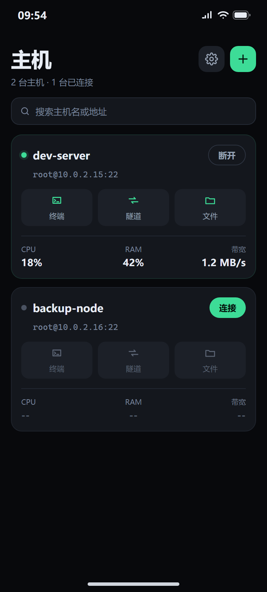
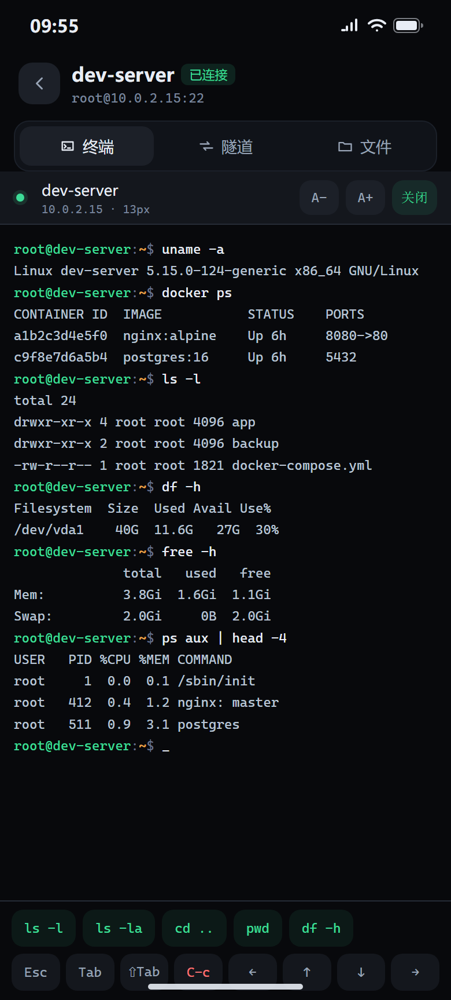
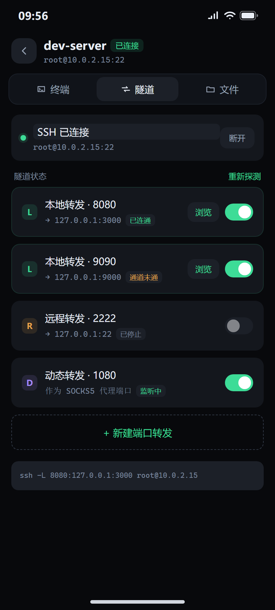
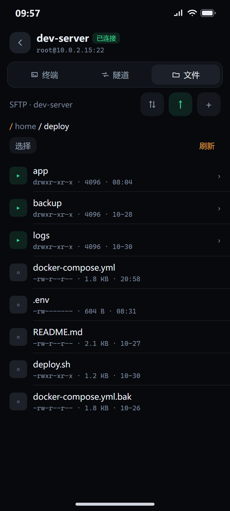

# 轻舟 Skiff

**版本** HarmonyOS 0.4.0 · Windows 0.2.0 · **许可** MIT

**跑在鸿蒙手机和 Windows 桌面上的 SSH + 隧道 + 文件传输。** 手机端竖屏重做，一键建转发、隧道通了直接开内置浏览器看面板；桌面端是单文件绿色版，一侧栏主机、多标签终端、双栏 SFTP。

[English](README.en.md) · [更新日志](CHANGELOG.md)

## 两个版本

| | HarmonyOS | Windows |
|---|---|---|
| 形态 | 手机 App（ArkTS + ArkUI） | 便携 exe，无安装、无运行时依赖 |
| 系统 | HarmonyOS 6.1（API 24） | Windows 10 / 11 x64 |
| 交互 | 竖屏触控，六行扩展键盘 | 鼠标键盘，可折叠侧栏 + 多标签 |
| 转发类型 | 本地 L / 远程 R / 动态 D | 本地 L / 远程 R |
| 查看面板 | 内置浏览器（ArkWeb） | 探测通道后用系统默认浏览器打开 |
| 签名 | 未签名包，需自行签名 | 未签名 exe |

两端共用一套 C++ SSH 协议内核（libssh2），界面层各自实现。

## 为什么做这个

我先是个使用者，不是运维工程师。

服务器在云上，服务是我自己部署的：几个 Web 面板、一些容器、几份配置。日常要看的、要改的，九成发生在手机上——排队、通勤、睡前躺床上。我不想把这些面板端口直接开到公网，比较稳妥的做法是只开 SSH，需要时用隧道把内网端口映射到自己这边，再用浏览器访问。

这套流程在电脑上很顺：`ssh -L 8080:127.0.0.1:3000 user@host`，然后开浏览器。搬到手机上就断了。

试过一圈现成方案，都不太对：

- **功能齐全的客户端**：桌面级 SSH 工具搬到手机，参数、菜单、弹窗层层嵌套，在 6 寸屏上点起来很费劲，隧道建完还得切到另一个 App 打开链接
- **轻量方案**：往往只有终端。隧道要手敲命令，或者根本不支持
- **共同缺失**：没有图形化的一键建隧道，也没有内置的"隧道建好后直接访问本地端口"的浏览器，两边来回切
- **语言**：几个做得不错的工具只有英文界面

所以决定按自己的需求做一个：**手机竖屏优先、三步把隧道建起来、隧道通了直接开内置浏览器看面板、中英双语**。

借助 AI 工具把重复的工程活压下去，协议内核沿用开源社区已有的实现（上游 [CrossShellNext](https://gitcode.com/OpenHarmonyPCDeveloper/CrossShellNext)），把精力集中在"手机上该怎么用"这件事上。

手机端做完之后，坐下来干活时又想要一个同款：不想在手机上打字，也不想装一个功能堆满、点起来费劲的桌面客户端。于是把同一套协议内核搬到了 Windows，界面按「一侧栏主机 + 多标签」重做，打成单个 exe —— 拷过去双击就能用，配置、日志、密钥都跟着程序走。

## 它替代了什么

| 以前 | 现在 |
|---|---|
| 手机装两个 App：一个 SSH 客户端 + 一个浏览器 | 一个 App，隧道与浏览页在同一会话里 |
| 敲 `ssh -L 8080:127.0.0.1:3000 user@host`，再复制链接到浏览器 | 填端口和目标，开关一拨，点「浏览」 |
| 隧道是否真的通了，只能靠浏览器报错反推 | 建立前先探测本机端口，未就绪给提示而不是白屏 |
| 隧道"显示开着"但实际已断 | 定时巡检真实转发状态，失效自动重建 |
| 英文界面里找设置 | 中英双语，设置内即时切换 |
| 桌面端装个大客户端，配置散在注册表和用户目录 | 单个 exe，配置与密钥跟着程序走，拷走即迁移 |
| 关掉终端窗口就等于断连，回来得重连重等 | 关标签不断连，重开还在原来的屏幕内容上 |
| 改窗口大小就错行、`bash` 设标题的转义串漏到屏幕上 | PTY 尺寸同步下发，CSI / OSC / DCS 完整解析 |

## 核心功能 · HarmonyOS

### 连接与认证

- **主机列表即首页**：启动落在列表，默认不自动连接；卡片显示状态灯、名称与实时 CPU / RAM / 网络占用（每 5 秒采集，未连接灰显 `--`）
- **卡片三入口**：每张卡片上「终端 / 隧道 / 文件」三个按钮，点击即连接并直达对应界面
- **认证**：密码（掩码输入）与私钥（RSA 2048 / ECDSA P-256 / Ed25519，可在应用内生成）
- **主机指纹校验**：首次连接记录服务器指纹（TOFU），之后每次在认证前比对，指纹变化直接拒绝并给出实际指纹；改地址或端口自动清空旧指纹
- **多会话并存**：不同主机可同时保持连接
- **代理**：支持 SOCKS5 与 HTTP 代理，连接前可测连通性

### 终端

- xterm.js 渲染真实 PTY 输出，内置 Cascadia Mono 等宽字体，字号可调
- **六行扩展键盘**：字母、数字符号、控制键、方向与编辑键分组，`Shift` / `Caps` 独立生效，`Ctrl` / `Alt` 组合直通，`Del`、`⌫` 分别发送对应控制序列
- 会话内顶部段控在终端 / 隧道 / 文件间一键切换，会话栏常驻主机名与断开
- 输出按帧合并渲染（16ms / 32KB 阈值），长时间刷屏不掉帧

### 端口转发

- **本地（L）/ 远程（R）/ 动态（D）** 三种类型独立表单，实时生成等效 `ssh -L/-R/-D` 命令行供核对
- 开关真实启停转发：失败回滚为关闭并说明原因，主机未连接时置灰
- **10 秒巡检**：按真实转发计数判断通道是否可用，不健康时自动停止重建并退避重试，绝不把失效写成「开着」
- L 型转发一键跳转**内置浏览页**，打开前先探测本机端口

### 浏览页

- 占满会话区的 ArkWeb，顶栏图标化工具栏（关闭 / 后退 / 前进 / 刷新）
- 加载失败给出原因与重试入口，加载超时显示诊断浮层而非一片黑

### 文件（SFTP）

- 目录浏览、面包屑、多选、新建目录、重命名、删除（文件夹递归）
- 上传下载带传输队列（进度 / 暂停 / 继续 / 取消），失败透传内核原始错误

### 日志与诊断

- **会话日志**：按会话独立落盘，可查看、导出、清除，自动保留最近 19 个
- **应用日志**：连接、转发、异常与崩溃按天写入沙箱，与会话日志分栏
- **全局错误观测**：未捕获异常与崩溃原因落盘

### 外观与语言

- 明暗双主题，切换即时生效（不重建页面）
- 中英双语，默认中文，设置内即时切换并保持；系统控件语言同步跟随
- 主机、隧道、主题、语言、字号、连接行为重启后全部保留

## 核心功能 · Windows

### 形态

- **单文件便携版**：静态链接 CRT 与 libssh2（WinCNG 后端，零 OpenSSL），解压即用
- **数据跟随程序**：`skiff_store.json` / `logs\` / `keys\` 落在 exe 同目录；目录不可写时回退 `%LOCALAPPDATA%\Skiff\`
- **全自绘界面**：Win32 + Direct2D / DirectWrite，无系统控件，跟随 DPI 缩放
- **可折叠侧栏**：展开 360px 显示主机卡片，收起 52px 只剩图标条，状态落盘记忆

### 主机与连接

- 侧栏主机列表即主操作区：搜索、按名称 / 最近连接排序、滚轮滚动
- **卡片实时性能**：底部三格显示 CPU / RAM / 网络速率，每 5 秒采一次 `/proc`，超过 60% 转警示色、85% 转危险色，未连接显示 `--`
- **卡片四入口**：连接 / 终端 / 隧道 / 文件；单击连接不切视图，双击卡片进终端
- 密码与私钥登录，`keys\` 目录自动匹配同名密钥；无凭据时直接打开该主机的编辑表单并提示
- 主机指纹校验（TOFU），首次记录、之后比对，不符直接拒绝并给出实际指纹
- 断线自动重连（指数退避）、启动时自动连接上次主机、启动时恢复上次界面
- 首页视图：主机与隧道统计、最近三台、注册与到期提醒、全量汇总

### 终端

- 真实 PTY，本地网格变化时同步 `winch` 到远端，改窗口大小不再错行
- 光标按 530ms 闪烁，窗口失焦时隐藏
- 完整解析 CSI / OSC / DCS 序列，`bash` 设窗口标题的转义串不会漏到屏幕上
- **关标签不断连**：关闭终端标签只移除标签，会话继续跑并与管道保活，重新打开回到原来的屏幕内容
- 标签栏、`Ctrl+1~4` 切换、`Ctrl+0` 回首页、`Ctrl+W` 关闭标签
- 字体、字号、光标样式、界面缩放可调，`Ctrl+滚轮` 即时缩放

### 端口转发

- **本地 L / 远程 R** 两种规则，表单实时展示所属主机与等效命令行
- 开关即真实启停，失败回滚为关闭并说明原因
- **10 秒巡检**：按真实转发计数判定通道状态，`up` / `listen` / `down` 三态区分，失效自动重建并退避（10 / 20 / 40 / 60 秒封顶），绝不把失效写成「开着」
- **浏览通道**：每行一个按钮，先探测 `127.0.0.1:<port>` 是否可达，通了弹出地址面板，可「用浏览器打开」或「复制地址」；不通给出提示并把该行降级为未连通

### 文件（SFTP）

- 左右双栏：本机目录与远端目录并排，面包屑导航、多选、新建文件夹
- 上传下载走后台队列串行执行，界面实时刷新进度，不阻塞终端
- 失败透传内核原始错误

### 外观与语言

- 18 项设置，分六组：常规 / 外观 / 终端 / 连接 / 日志 / 关于
- 5 套强调色、界面缩放、等宽字体与字号、光标样式
- 中英双语 287 条词表，切换即时生效
- 日志分级、保留天数、日志目录一键打开与清理

### 快捷键

| 键 | 作用 |
|---|---|
| `Ctrl+0` | 回首页 |
| `Ctrl+1` ~ `Ctrl+4` | 切换前四个标签 |
| `Ctrl+W` | 关闭当前标签（不断连） |
| `Ctrl+滚轮` | 缩放终端字号 |
| `Ctrl+C` / `Ctrl+V` | 复制 / 粘贴（终端内有选区时按选区复制） |

## 使用场景

**1. 手机上看服务器面板**
容器管理、监控面板、自建后台都只监听 `127.0.0.1`。建一条 L 转发把面板端口映射到手机本地，点「浏览」直接看，不用把端口开到公网。

**2. 临时改配置、看日志**
连上就是完整 PTY，`vim`、`tail -f`、`systemctl` 都能用；六行扩展键盘补齐了手机输入法缺的 `Esc`、`Tab`、`Ctrl`、方向键。

**3. 手机与服务器互传文件**
SFTP 面板里上传下载，带队列与进度，失败时能看到内核原始错误而不是笼统的"上传失败"。

**4. 断线后确认到底发生了什么**
会话日志与应用日志分开存，按时间翻，比"重连一下试试"高效。

## 界面预览

**HarmonyOS**：按 390×863vp 竖屏基准渲染，主机名与地址为示例占位。

| 主机列表 | 终端 |
|:---:|:---:|
|  |  |

| 端口转发 | 文件浏览 |
|:---:|:---:|
|  |  |

## 运行方式

### HarmonyOS

#### 环境要求

- DevEco Studio（SDK 对齐 API 24 / HarmonyOS 6.1），`DEVECO_HOME` 指向安装目录
- HarmonyOS 模拟器（x86_64）或真机（arm64-v8a）
- 构建缓存建议指向非系统盘（`HVIGOR_USER_HOME`）

#### 构建与出包

推荐用 `release.py`，一次完成版本推进、构建、摘除未配置的签名项、归集产物与 SHA256：

```bash
git clone <本仓库地址>
cd Skiff
python release.py                  # release 包（arm64-v8a）
python release.py --abi both       # 双架构
python release.py --debug          # debug 构建
python release.py --no-bump        # 不推进版本号
python release.py --dry-run        # 只打印将要执行的步骤
```

Windows 下可直接双击 `release.bat`。产物归集到仓库外的 `产出/`（含 `.sha256`）。

#### 安装

```bash
hdc install 产出/Skiff-<version>-arm64-v8a-release-unsigned.hap
```

也可以用 DevEco Studio 打开工程直接运行，等价于
`hvigorw assembleHap --mode module -p product=default -p buildMode=debug --no-daemon`（`hvigorw` 来自 DevEco Studio 工具链，不在仓库内）。

#### 首次使用

1. 首页右上角 **+** 新建主机：填地址、端口、用户名，选密码或密钥，保存
2. 点卡片右侧「连接」，首次连接会记录主机指纹（TOFU）
3. 点卡片上「终端 / 隧道 / 文件」任一入口进入会话，顶部段控可随时切换
4. 隧道页 **+ 新建端口转发**：选类型（L/R/D）、填本机端口与目标，保存后拨开关
5. L 型转发拨到开启后点「浏览」，内置浏览器直接打开本机端口对应的服务

#### 原生依赖

C++ 内核基于 **libssh2 1.11.1 + OpenSSL 1.1.1w** 静态链接，仓库自带 `entry/libs/arm64-v8a/` 与 `entry/libs/x86_64/` 两套静态库，构建脚本按 `OHOS_ARCH` 自动选择。

### Windows

#### 环境要求

- Visual Studio 2022（MSVC v143 工具链）
- CMake 与 Ninja（VS 安装时自带的即可）
- 无需额外依赖：libssh2 静态库与静态 CRT 随仓库提供，产出不依赖任何运行库

#### 构建

```bat
cd win
build.bat
```

脚本顶部 `VSDIR` 需指向本机的 Visual Studio 安装目录，其余无需配置。产物为 `win\build\bin\Skiff.exe`，直接双击运行。

想自己调 CMake 参数：

```bat
cmake -S win -B win\build -G Ninja -DCMAKE_BUILD_TYPE=Release
cmake --build win\build
```

#### 首次使用

1. 展开左侧栏，点底部「新建主机」，填地址、端口、用户名，选密码或密钥，保存
2. 点卡片上的「连接」，首次连接会记录主机指纹（TOFU）
3. 双击卡片进终端；单击「终端 / 隧道 / 文件」直达对应页面
4. 隧道页新建规则时选「本地 L」或「远程 R」，填本地端口与目标，保存后拨开关
5. 规则连通后点行内「浏览通道」，探测通过即可用系统浏览器打开 `127.0.0.1:<port>`

#### 数据位置

| 内容 | 路径 |
|---|---|
| 主机、隧道、设置 | `skiff_store.json`（exe 同目录） |
| 应用日志 | `logs\app-yyyyMMdd.log`（保留 7 天，按设置清理） |
| 密钥 | `keys\`（exe 同目录，同目录不可写时回退 `%LOCALAPPDATA%\Skiff\`） |

## 当前边界

### HarmonyOS

- **未签名**：产物均为未签名包，只能装到调试设备；正式分发需自行签名
- **认证方式有限**：仅密码与公钥，不支持 keyboard-interactive，需要 2FA 的服务器无法登录
- **后台常驻未充分验证**：「后台保持隧道」已实现，真机长时间后台存活仍需实测
- **「保活」开关语义**：关闭后内核仍按默认 60 秒发探测包，开关实际作用是切到应用层心跳兜底
- **转发类型验证不均**：本地（L）转发与内置浏览页已联机验证；远程（R）与动态（D）仅完成实现
- 桌面形态页面保留在代码中但不在导航路径上

### Windows

- **未签名**：exe 未做代码签名，首次运行可能被 SmartScreen 拦一次
- **无动态转发**：只支持本地 L 与远程 R，暂无 `-D` 动态 SOCKS
- **无内置浏览器**：通道连通后用系统默认浏览器打开，不在应用内渲染页面
- **认证方式有限**：仅密码与公钥，不支持 keyboard-interactive，需要 2FA 的服务器无法登录
- **联机回归未覆盖全部功能**：连接、转发、SFTP、统计轮询在真实服务端上的长时间稳定性仍需实测
- 版本线与手机端相互独立，桌面端当前为 0.1.x

## 架构

两端共用同一套 C++ 协议内核，界面层各自实现。

**HarmonyOS**

```
ArkTS 界面层   pages/mobile/*  主机列表 / 终端 / 隧道 / 文件 / 浏览 / 设置
      ↓         common/  SshService · KeyStore · Store · AppLog · PortProbe
NAPI 桥接层    entry/src/main/cpp/napi*.cpp
      ↓
C++ 内核层     libssh2（会话 / 通道 / SFTP） + 转发线程 + keepalive 线程
```

主机与设置统一走 preferences 单文件持久化（`skiff_store`）。

**Windows**

```
自绘界面层     win/src/ui/    Chrome（布局与命中） · Views（页面绘制） · Render（D2D 封装）
      ↓                       Terminal（终端仿真） · Sessions（终端池）
应用层         win/src/app/   App（全局状态） · Config · Layout · Lang · Theme
      ↓
服务层         win/src/core/  SshService（map<id, Item>，全部接口带 id）
      ↓
兼容层         win/src/compat/  POSIX → Winsock（Platform.h 强制包含）
      ↓
C++ 内核层     libssh2 1.11.1（WinCNG 后端，静态链接）
```

配置为单文件 JSON `skiff_store.json`，日志与密钥落在 exe 同目录。

## 里程碑

**HarmonyOS**

| 阶段 | 内容 | 状态 |
|---|---|---|
| P0 | 真实建连 + 真实终端 | 完成 |
| P1 | 隧道 L / R / D 真实转发 + 内置浏览页 | 完成 |
| P2 | SFTP 真实传输（含队列与中断） | 完成 |
| P3 | 持久化 + 密钥库 + 主机指纹 | 完成 |
| P4 | 会话日志 + 应用日志 + 断线自动重连 | 完成 |
| P5 | 双架构（arm64-v8a + x86_64）打包 | 完成 |
| P6 | 状态真实性收口：全局心跳、隧道巡检、回前台探活、假功能清理 | 完成 |

**Windows**

| 阶段 | 内容 | 状态 |
|---|---|---|
| W0 | 骨架：Win32 + Direct2D 自绘无边框窗口 | 完成 |
| W1 | 接入 SSH 内核，POSIX 兼容层 + libssh2 WinCNG 静态链接 | 完成 |
| W2 | 功能对齐：终端 / 隧道 / SFTP / 设置 / 中英切换 | 完成 |
| W3 | 状态真实性收口：光标闪烁、PTY 尺寸同步、OSC 解析、关标签不断连、通道浏览 | 完成 |

## 参与

欢迎 Issue 与 PR。界面改动请在模拟器或真机上实际操作验证，不以截图代替。

## 许可与致谢

本项目基于 [MIT License](LICENSE) 开源。

- 上游：[CrossShellNext](https://gitcode.com/OpenHarmonyPCDeveloper/CrossShellNext) —— SSH / Telnet / SFTP 协议内核与桌面端实现
- 终端字体：[Cascadia Mono](https://github.com/microsoft/cascadia-code)（MIT）
- 终端渲染：[xterm.js](https://xtermjs.org/)（MIT）

---

**轻舟 Skiff** —— 口袋里的远程运维，轻舟已备，只待扬帆；桌面版同舟。
