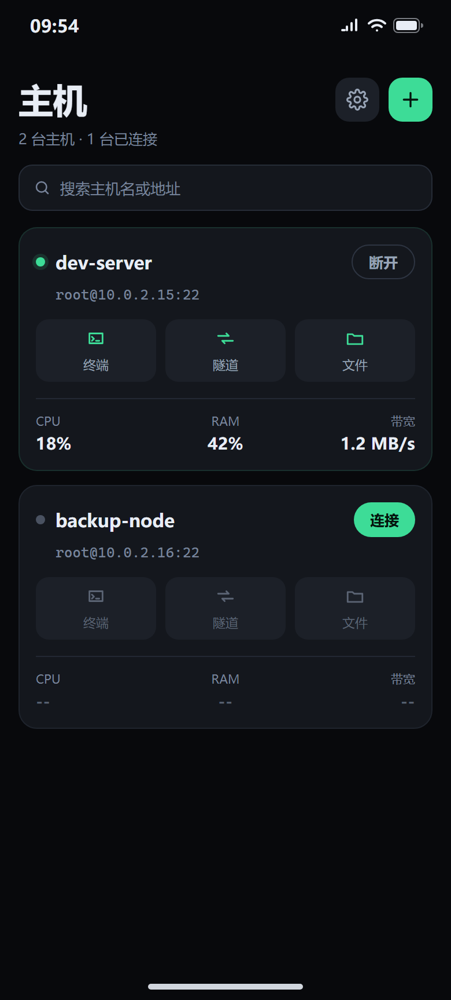
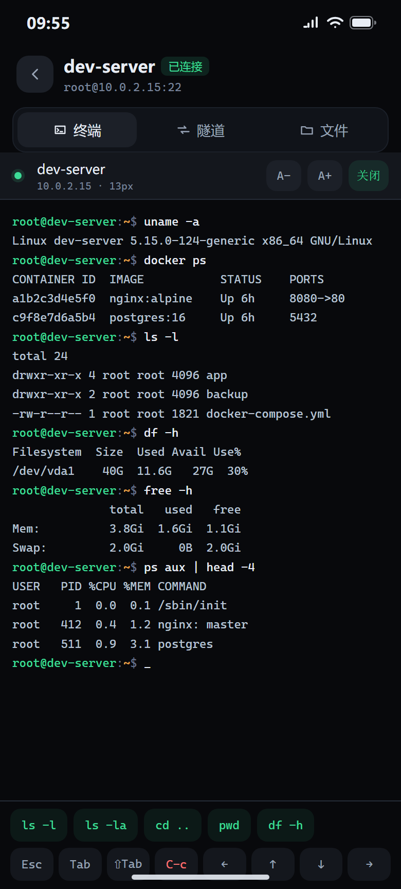
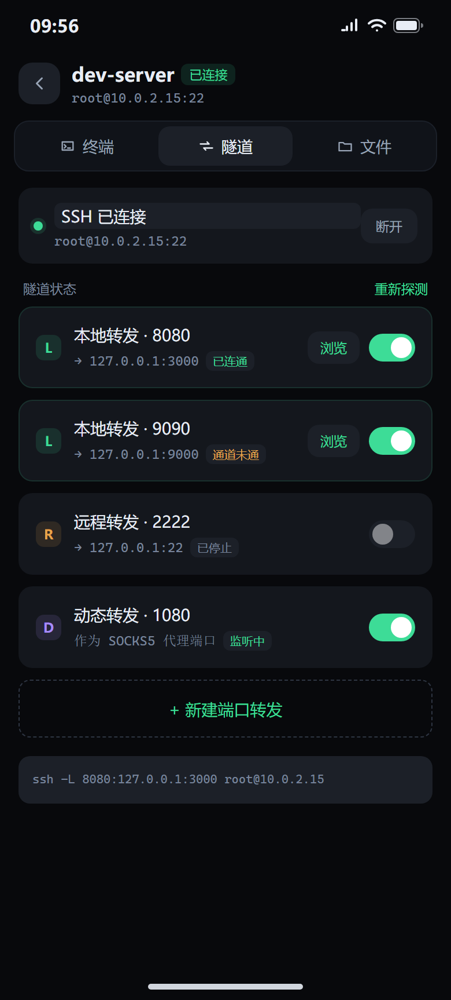
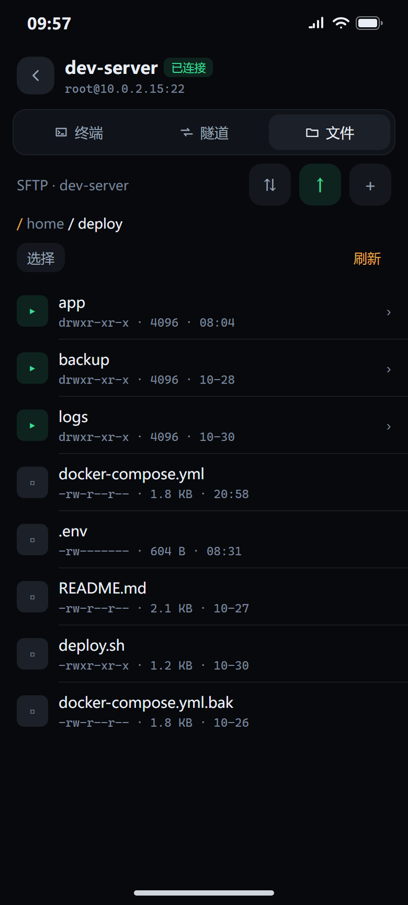

# 轻舟 Skiff 0.3.1

**跑在鸿蒙手机上的 SSH + 隧道 + 内置浏览器。** 首个公开版本。

## 关于这个版本

0.1.x 与 0.2.x 是内部迭代，只在模拟器与自用设备上跑。0.3.1 是第一个对外发布的版本：主机管理、终端、SFTP、端口转发、内置浏览、日志、主题与语言全链路可用，状态真实性收口（P6）已完成。

它解决的是这样一个断点：服务器在云上，日常想看的、想改的九成发生在手机上；把面板端口开到公网不安全，于是只开 SSH，用隧道把内网端口映射到本机。电脑上 `ssh -L 8080:127.0.0.1:3000 user@host` 再开浏览器很顺，搬到手机上要装两个 App、手敲命令、再复制链接。Skiff 把这三步合成一个会话：填端口和目标，拨开关，点「浏览」。

## 主要功能

**连接与认证**
主机列表即首页，卡片显示状态灯与实时 CPU / RAM / 网络占用（每 5 秒采集）。支持密码与私钥（RSA 2048 / ECDSA P-256 / Ed25519，可在应用内生成），首次连接记录主机指纹（TOFU），之后每次认证前比对，指纹变化直接拒绝并给出实际指纹。支持 SOCKS5 与 HTTP 代理。

**终端**
xterm.js 渲染真实 PTY，内置 Cascadia Mono，字号可调。六行扩展键盘补齐手机输入法缺的 `Esc`、`Tab`、`Ctrl`、`Alt`、方向与编辑键，`Del` 与 `⌫` 分别发送对应控制序列。输出按 16ms / 32KB 合并渲染，长时间刷屏不掉帧。

**端口转发**
本地（L）/ 远程（R）/ 动态（D）三种类型独立表单，实时生成等效 `ssh -L/-R/-D` 命令行供核对。每 10 秒巡检一次真实转发状态，失效自动停止重建并按 10/20/40/60 秒退避，绝不把失效写成「开着」。

**内置浏览**
L 型转发一键跳转内置浏览器，打开前先探测本机端口，未就绪给提示而不是白屏。加载失败给出原因与重试入口，超时显示诊断浮层。

**文件**
SFTP 目录浏览、面包屑、多选、新建目录、重命名、删除（文件夹递归）。上传下载带队列与进度，可暂停、继续、取消，失败透传内核原始错误。

**日志与外观**
会话日志与应用日志分栏落盘，可查看、导出、清除。明暗双主题即时切换不重建页面，中英双语即时切换且系统控件语言同步跟随，主机、隧道、主题、语言、字号、连接行为重启后全部保留。

## 本版变更（相对 0.2.1）

### 新增

- 「重新探测」有了进行中反馈：点击后按钮转圈并显示「检测中」，探测结束才复原；即使结果与之前相同也能确认操作已生效。隧道条目上的状态徽标点击同样会短暂显示「检测中」

### 变更

- 主机列表底部留白收紧：列表底部内边距由 30vp 减至 12vp，滚到底时最后一张卡片更贴近屏幕底边

## 界面预览

| 主机列表 | 终端 |
|:---:|:---:|
|  |  |

| 端口转发 | 文件浏览 |
|:---:|:---:|
|  |  |

## 安装

| 项 | 值 |
|---|---|
| 产物 | `Skiff-0.3.1-arm64-v8a-release-unsigned.hap` |
| 大小 | 8.41 MB |
| SHA-256 | `da8d8db9a7b0726a643dce69b19a30ff8501634932d714c8b84f1228b2a9fadd` |
| 适用 | HarmonyOS 6.1 / API 24，arm64-v8a 真机 |
| 签名 | 未签名，需自行签名后安装 |

```bash
hdc install Skiff-0.3.1-arm64-v8a-release-unsigned.hap
```

x86_64 包（模拟器）需在本地构建：

```bash
python release.py --abi both
```

## 已知限制

- **未签名**：产物均为未签名包，只能装到调试设备；正式分发需自行签名
- **认证方式有限**：仅密码与公钥，不支持 keyboard-interactive，需要 2FA 的服务器无法登录
- **后台常驻未充分验证**：「后台保持隧道」已实现，真机长时间后台存活仍需实测
- **「保活」开关语义**：关闭后内核仍按默认 60 秒发探测包，开关实际作用是切到应用层心跳兜底
- **转发类型验证不均**：本地（L）转发与内置浏览页已联机验证；远程（R）与动态（D）仅完成实现

## 内核与依赖

C++ 内核基于 **libssh2 1.11.1 + OpenSSL 1.1.1w** 静态链接，NAPI 桥接，ArkTS 界面层。仓库自带 `entry/libs/arm64-v8a/` 与 `entry/libs/x86_64/` 两套静态库，构建脚本按 `OHOS_ARCH` 自动选择。

## 许可与致谢

基于 [MIT License](../LICENSE) 开源。

- 上游：[CrossShellNext](https://gitcode.com/OpenHarmonyPCDeveloper/CrossShellNext) —— SSH / Telnet / SFTP 协议内核与桌面端实现
- 终端字体：[Cascadia Mono](https://github.com/microsoft/cascadia-code)（MIT）
- 终端渲染：[xterm.js](https://xtermjs.org/)（MIT）
